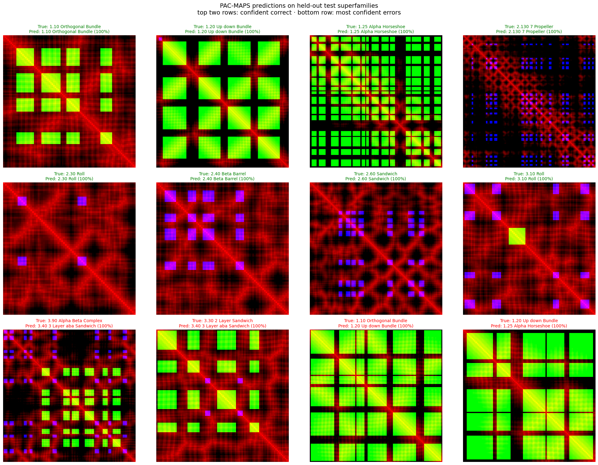

# PAC-MAPS

**P**rotein **A**rchitecture **C**lassification from contact **MAPS**

A CNN that predicts a protein domain's [CATH](https://www.cathdb.info/) architecture (e.g. *β-barrel*, *3-layer αβα sandwich*) from its Cβ contact map alone. Every test domain comes from a **superfamily the model never saw in training**, so the score measures generalization to new superfamilies, not recognition of close homologs.

Across three independent superfamily splits, PAC-MAPS reaches **74 ± 4% balanced accuracy (~10× chance over 14 classes)**, matching **Foldseek** nearest-neighbor structural search (75 ± 5%) while using only a 2D contact representation.



*Predictions on held-out test superfamilies (split seed 2002). Top two rows: the most confident correct prediction for eight architectures. Bottom row: the most confident distinct errors.*

---

## Approach

**Leakage-aware splits.** Whole CATH superfamilies are held out for validation and test, so no close homolog of a test domain appears in training. Random domain-level splits leak homologs across the split and inflate accuracy, which is one of the most common pitfalls in structural ML.

**One pixel = one residue.** Each domain becomes an L×L image, zero-padded to 400×400 and never resized, so the pixel scale of helices, strands and their packing stays physically meaningful across domains of different lengths.

**Structure-aware input channels.**

| Channel | Encodes |
|---|---|
| R | Cβ–Cβ distance, inverted and clipped at 30 Å (bright = close) |
| G | residue pairs where both residues are in helices |
| B | residue pairs where both residues are in strands |

Secondary structure is assigned with biotite's P-SEA (`annotate_sse`). In the images, helix–helix blocks appear green (yellow where the helices pack closely) and strand–strand blocks appear blue (purple where the strands pair).

**Model.** A dilated residual CNN with squeeze-and-excitation blocks and a sequence-separation coordinate channel (log |i − j|, in residues), trained with class-balanced sampling and one geometrically valid augmentation: N↔C sequence reversal (flipping the map about its anti-diagonal).

---

## Results

### Stage 1: architecture selection

Early pipeline: 224 px resized binary contact maps on a preliminary split. Numbers are comparable within this table only.

| Model | Best val. bal. acc. |
|---|---|
| ResNet34 (fine-tuned) | 0.60 |
| Vanilla CNN | 0.72 |
| Dilated residual CNN + SE | 0.77 |
| **+ CoordConv (sequence separation)** | **0.82** |

### Stage 2: final pipeline

Superfamily-held-out splits, 400 px zero-padding, Cβ distance ≤ 30 Å + SSE channels, dilated CoordConv CNN, 18 epochs, one model per split.

| Split seed | Val. bal. acc. | Test acc. | Test bal. acc. |
|---|---|---|---|
| 42 | 0.696 | 0.67 | 0.69 |
| 16 | 0.701 | 0.82 | 0.77 |
| 2002 | 0.686 | 0.77 | 0.75 |
| **Mean ± SD** | **0.694 ± 0.008** | **0.75 ± 0.08** | **0.74 ± 0.04** |

### Stage 3: benchmark against Foldseek

Same three test sets. Foldseek searches each seed's test domains against that seed's training domains only.

| Method | Input | Test acc. | Test bal. acc. |
|---|---|---|---|
| **PAC-MAPS** | 2D Cβ distance map + SSE channels | 0.75 ± 0.08 | **0.74 ± 0.04** |
| Foldseek, top-1 nearest neighbor | full 3D structure | 0.80 ± 0.04 | 0.73 ± 0.05 |
| Foldseek, top-5 majority vote | full 3D structure | **0.81 ± 0.04** | **0.75 ± 0.05** |

PAC-MAPS matches Foldseek on balanced accuracy while using only a 2D contact representation. Foldseek achieves higher overall accuracy, driven by better performance on the largest architectures. The two methods distribute their errors differently: PAC-MAPS's accuracy and balanced accuracy are nearly equal, while Foldseek is stronger on the large classes that dominate plain accuracy.

*SD is the sample standard deviation across the three seeds. Foldseek was run with `easy-search` in exhaustive mode (E ≤ 10); top-5 ties are broken by summed bit score, and the ~2% of queries with no hit are counted as errors. Chance balanced accuracy ≈ 7%. Small classes such as 3.50 may be absent from some test sets, so per-seed balanced accuracy can cover slightly different class sets.*

### What the errors show

The model's mistakes fall between architectures that are geometrically close, and they point at specific information the input lacks:

- **1.10 Orthogonal vs. 1.20 Up-down Bundle** is the most persistent confusion. The two differ mainly in helix crossing angles, which a distance map does not encode, so their contact maps look alike (bottom row, third panel).
- **2-layer (3.30) vs. 3-layer (3.40) sandwiches** differ in whether helices pack against one face of the β-sheet or both. Recall on 3.40 ranges from 66% to 98% depending on which superfamilies are held out.
- **3.90 Alpha Beta Complex** is CATH's catch-all α/β class; its domains are often predicted as the layered architecture their core most resembles.
- **Distinctive folds are solved on every split:** the 7-bladed propeller (2.130) and α/β barrel (3.20) at 99–100%, and the β-sandwich (2.60) at 93–99%.

---

## Limitations

- Superfamilies are held out, but topologies (folds) are not, so some test domains have a same-fold relative in training.
- No orientation information: helix crossing angles and parallel vs. antiparallel packing are only implicit, which drives the α-bundle confusions.
- The model is overconfident: its most confident errors are made at ~100% predicted probability.
- Results come from three splits; per-split test balanced accuracy varies by ±4 points depending on which superfamilies are held out.
- Single-domain inputs only. Multidomain chains would need a domain parser (e.g. Chainsaw, Merizo) first.

## Future work

- An orientation channel (cosine between local backbone directions for residue pairs) to separate helix crossing angles and parallel vs. antiparallel sheets.
- A global-context (self-attention) block, so distant contact patterns such as β-barrel closure can interact directly.
- Calibration via label smoothing or temperature scaling.
- Combining PAC-MAPS probabilities with Foldseek top-k votes, since the two methods err differently.

---

## Repository

```
pac-maps/
├── PAC_MAPS.ipynb        # full pipeline: data → contact maps → splits → training → evaluation → Foldseek benchmark
├── splits/               # exact superfamily splits for seeds 42, 16 and 2002
├── figures/              # prediction gallery and confusion matrices
├── requirements.txt
└── README.md
```

## Reproducing

1. Open `PAC_MAPS.ipynb` in Google Colab or Kaggle with a GPU runtime.
2. Add your Weights & Biases API key as a secret named `WANDB_API_KEY`, and set `WANDB_ENTITY` / `WANDB_PROJECT` in the config cell.
3. Run the notebook top to bottom. It downloads the CATH S40 non-redundant domain set, generates the contact maps, and trains on the splits in `splits/`.
4. The Foldseek benchmark cells at the end run on CPU (or GPU with the Foldseek GPU build).

Training one model takes ~1.5 hours on a single T4 (18 epochs). Full training logs are on [Weights & Biases](https://wandb.ai/murto-university-of-waterloo/protein-architecture-classification).

**Stack:** PyTorch, fastai, biotite, scikit-learn, Foldseek, Weights & Biases.